<picture>
  <source media="(prefers-color-scheme: dark)" srcset="assets/header-dark.svg">
  
</picture>

The line above is real: forty hours of my platform's power, sampled every five minutes.

The grey band is the moment a tenant spent its energy budget, and a controller I wrote put it to sleep. Nothing broke. It just slept, and woke up when it was allowed to.

That is what I build: platforms that know what every tenant costs, in watts, and act on it.

[azzhomelab.tech](https://azzhomelab.tech)
